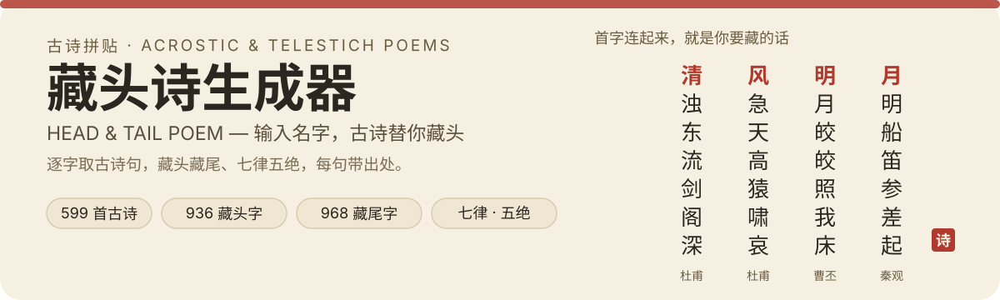

<p align="right"><a href="README.md">中文</a></p>

<p align="center">
  
</p>

<p align="center">
  <a href="https://head-tail-poem.xiaosang.cc/">▶ Generate Online</a>
  ·
  <a href="https://github.com/holynova/head_tail_poem">GitHub Repository</a>
</p>

A Chinese acrostic and telestich poem generator: type any phrase — a name, a blessing, a slogan — and it picks classical verse line by line to hide your words at the start (or end) of each line. The default example "清风明月水落石出" composes an 8-line poem in one tap, with the source of every line cited (dynasty / author / poem title). Mobile-first, no setup.

## Screenshots

<p align="center">
  
</p>

## Features

- **Acrostic / telestich** (藏头 / 藏尾): switch with one tap — hide your words at the head or the tail of each line.
- **7-character / 5-character lines** (七律 / 五绝): two line lengths, seven-character by default.
- **Per-line refresh**: tap ↻ next to any line to swap just that line, without regenerating the whole poem.
- **Citations**: every line shows its dynasty, author, and poem title below; hide them with one tap to read just the poem.
- **One-tap copy**: copy the whole poem to the clipboard, ready to share.

## Corpus

The verse library comes from 599 classical poems, indexed twice — by first character and by last character (2,693 lines each) — then split into per-character JSON chunks loaded on demand, so the first screen never carries the whole library:

| Index | Characters | Lines |
|------|------|------|
| Head (藏头) | 936 | 2,693 |
| Tail (藏尾) | 968 | 2,693 |

Corpus build scripts live in `backend/` (`raw.json` → `makeDict.js`, splitting by character).

## Run Locally

```bash
npm install
npm run dev      # development
npm run build    # build, output in docs/ (GitHub Pages serves the docs directory directly)
```

## Tech

- React 17 + TypeScript + Vite 2, UI with antd-mobile 5, mobile-first.
- Dictionaries split by character: `import.meta.glob` loads them dynamically, fetching only the characters used.
- Build output is committed in `docs/`, so GitHub Pages works out of the box.

```
src/pages/PoemPage.tsx   Main page: input / selectors / generate / copy
src/pages/components/    PoemRow (one line + swap), HighlightString (highlight the hidden character)
src/common/dict/         Dictionaries: head/ 936 characters, tail/ 968 characters
backend/                 Corpus build: raw.json + makeDict.js
docs/                    Build output (Pages deployment directory)
```
